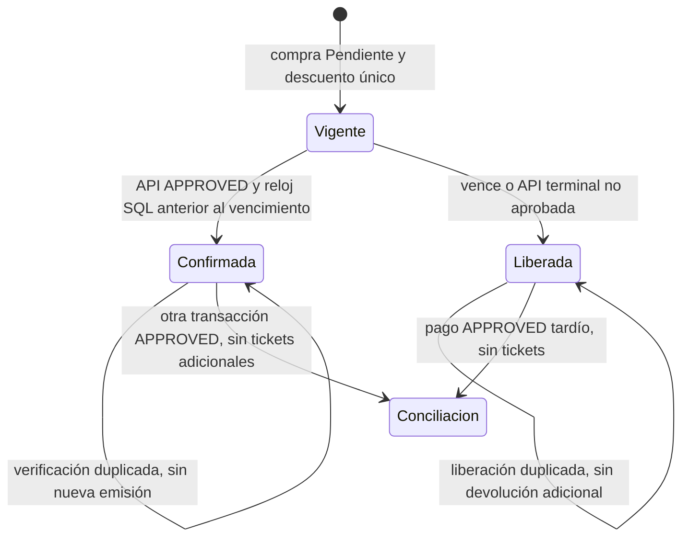

# UGP — Corrección de inventario y reservas

Fecha: 10 de noviembre de 2026. Base Git: `main`, `62bdf1d`.

**Dictamen: implementación preparada; NO aprobada para despliegue ni cerrado el inventario de Entrega 3.** D-01 y D-02 están autorizadas. Falta revisar y autorizar la ejecución de los scripts, aplicarlos en SQL Server desechable y ejecutar las pruebas críticas. No se conectó este trabajo a la base para escribir datos, no se ejecutó SQL, no se realizaron pagos, commits ni push.

## 1. Causa raíz y cambios implementados

La compra descontaba `Eventos.tickets_disponibles` una vez, pero no tenía vencimiento persistido, devolución transaccional ni recepción durable de transacciones al cerrar el navegador. La verificación del rechazo solo mostraba un mensaje. Las localidades calculan ocupación con detalles de compras Pendiente/Aprobado; ese cálculo continúa intacto: cambiar la compra a Expirada/Rechazado/Cancelado y devolver el saldo global sucede en la misma transacción.

Se implementaron:

- Reserva independiente de la compra, con creación UTC del reloj SQL, vencimiento a 15 minutos, estado, confirmación, fecha/motivo de liberación e ID de operación.
- Intento de checkout con referencia, entorno, importe y moneda persistidos dentro de la transacción que crea la compra, antes de entregar el checkout. Se conserva el formato de referencia existente.
- Varias transacciones Wompi por intento, con ID único por entorno, estado verificado y agenda persistente de conciliación.
- Bandeja durable de IDs autenticados: `POST /pagos/wompi/eventos`. Requiere HTTPS, secreto de eventos del entorno, firma válida y tamaño máximo de 32 KiB. El HTTP 200 significa que se guardó el ID, no que el pago se aprobó.
- Consulta privada del proveedor y cotejo de ID, referencia, centavos y moneda antes de vincular o cambiar la compra. El ID firmado se guarda sin confiar en la referencia del cuerpo, que puede no estar cubierta por las propiedades firmadas.
- Procesamiento periódico independiente para expiración y conciliación. Un fallo de red no se convierte en rechazo ni bloquea la liberación por esperar a Wompi.
- Confirmación y emisión en la misma transacción; rechazo/anulación/error terminal verificados cierran esa compra y liberan una sola vez. Un cobro posterior de cualquier otro intento requiere conciliación.
- Incidencia única por pago aprobado sin reserva o por cobro adicional. No hay reembolsos automáticos.
- Asistentes de la reserva persistidos en JSON para sobrevivir al reinicio; se elimina esa copia al liberar o completar la emisión. No se modifica el perfil compartido del visitante ni se almacena información de tarjetas.
- Expiración firmada enviada tanto a Widget (`expirationTime`) como a Web Checkout (`expiration-time`). Se conserva la omisión del retorno localhost en Development y el resto del contrato de Wompi.
- Eliminado el bloque de migraciones y siembra automática del arranque. Los scripts revisados son la fuente de verdad del esquema; `Database:InitializeOnStartup` ya no ejecuta cambios.

## 2. Archivos de esta intervención

Modificados (varios ya tenían cambios locales):

- `Data/ApplicationDbContext.cs`: registro del nuevo mapeo.
- `Controllers/PasarelaController.cs`: exige reserva persistida vigente y envía expiración firmada.
- `Services/Implementations/CompraService.cs`: reserva/intento atómicos, reloj SQL, operación estable durante reintentos y delegación de verificación.
- `Services/Implementations/WompiCheckout.cs`: firma con expiración, autenticación de eventos y lectura validada de transacciones.
- `Program.cs`: servicios y worker; eliminación de migración/siembra automática.
- `UGP(ultimo guerrero en pie).csproj`: excluye el ejecutable de pruebas del proyecto web y su publicación.
- Este informe y `Documentacion/CHANGELOG_ARQUITECTURA.md`.

Creados:

- `Models/Entities/ReservaCompra.cs`: reserva, intento, transacción e incidencia.
- `Data/ReservasMapping.cs`: relaciones, tipos e índices EF.
- `Services/Implementations/ReservaTransaccion.cs`: bloqueo transaccional y reloj SQL.
- `Services/Implementations/ReservasService.cs`: expiración, verificación, emisión y conciliación.
- `Services/Implementations/ReservasWorker.cs`: recuperación periódica.
- `Controllers/WompiEventosController.cs`: recepción autenticada.
- `Sql/UGP_0002_ReservasPagos.sql`: esquema aditivo para revisión.
- `Sql/UGP_0003_AdopcionReservasHistoricas.sql`: plantilla de adopción histórica para revisión separada.
- `Tests/Reservas/Reservas.Checks.csproj` y `Tests/Reservas/Program.cs`: pruebas aisladas y arnés SQL sin paquetes nuevos.

No se modificaron el diseño, Home, detalle, servicios de QR/PDF, cookies ni datos SQL en esta intervención. Sus modificaciones anteriores permanecen en Git.

## 3. Scripts y revisión previa obligatoria

**Ambos scripts están SIN APLICAR.** El directorio real solo tenía `UGP_Database_Schema.sql`; no se encontró un archivo llamado V0001. Ese baseline conserva exactamente el hash Git `0b1af857cf8480e059b340a1ffbf38381817d568`.

`UGP_0002_ReservasPagos.sql` crea cuatro tablas, relaciones sin cascada, índices de vencimiento/conciliación y unicidad por compra, operación, referencia e ID Wompi. Agrega un CHECK al inventario de Eventos: entre cero y capacidad máxima. El CHECK valida las filas existentes; si hay corrupción, el script falla en vez de corregir datos silenciosamente. El TTL queda limitado por CHECK a 15 minutos. Una incidencia resuelta exige fecha y evidencia. El script utiliza transacción y XACT_ABORT, y rechaza una segunda aplicación; no modifica el historial EF.

Impacto: almacenamiento adicional, datos personales transitorios de asistentes, validación/bloqueo del inventario al aplicar el CHECK, y despliegue coordinado del esquema y código. No aplicar con instancias antiguas escribiendo inventario. Los permisos de la cuenta de aplicación deben permitir `sp_getapplock` y el acceso a las nuevas tablas.

`UGP_0003_AdopcionReservasHistoricas.sql` NO adivina UTC ni selecciona compras masivamente. Exige un manifiesto explícito de compras pendientes Wompi, sin tickets y ya vencidas, con fechas UTC verificadas. La plantilla vacía lanza error. Prepara las reservas/intentos para que el worker las libere bajo D-02; no cambia aforo directamente. Se debe revisar el efecto sobre cada comprador y conciliar antes de aprobar ese manifiesto. Las referencias conservan la fecha original de compra.

**Sin adopción, las compras históricas siguen reteniendo el inventario que ya tenían.** No pueden abrir checkout ni emitir automáticamente usando la nueva ruta sin reserva. Este punto impide declarar resuelto el inventario histórico.

## 4. Estados

La incidencia no reemplaza el estado terminal de la reserva. La compra conserva Aprobado, Expirada, Rechazado o Cancelado según la decisión inicial. La transacción conserva su estado Wompi por separado. APPROVED es absorbente; una respuesta PENDING atrasada no revierte un terminal. Una aprobación posterior a un rechazo pasa por la política de reserva liberada.

## 5. Concurrencia e idempotencia implementadas, aún por demostrar en SQL

- Creación, liberación y confirmación adquieren `sp_getapplock` exclusivo con dueño Transaction por evento. Se libera al commit/rollback y coordina procesos diferentes, no solo memoria local.
- La creación mantiene SERIALIZABLE, validación de localidad/cupos/precios y un ID de operación estable durante los reintentos de EF, incluso ante commit de resultado incierto.
- Las decisiones vuelven a leer la reserva después de obtener el bloqueo. La devolución de cupos usa una actualización SQL condicionada a los límites de capacidad. Estado, motivo y devolución se guardan juntos.
- La aprobación no vuelve a descontar. Estado aprobado, tickets y asistentes se confirman juntos; una excepción revierte todos. El segundo verificador observa la transacción ya aprobada.
- La bandeja usa otro bloqueo transaccional por entorno/ID y un índice único. La incidencia tiene unicidad por transacción. No se guardan payloads con tarjetas ni secretos.
- Ninguna llamada HTTP se hace dentro de la transacción de inventario.
- La expiración lógica es a los 15 minutos. La devolución física ocurre en el siguiente lote, normalmente cada 10 segundos; una caída de SQL/aplicación o una cola grande añade retraso. Al reiniciar se vuelven a seleccionar los vencimientos persistidos. No se promete liberación física puntual durante una caída.
- La consulta de disponibilidad pública sigue leyendo el inventario confirmado; puede reflejar el cupo retenido hasta finalizar ese lote. La creación intenta procesar vencimientos del evento antes de reservar y luego valida el saldo real.

## 6. Activación y conciliación

**El nuevo flujo está deshabilitado por defecto (`Reservas:Habilitadas=false` al no configurarlo).** Mientras permanezca así, creación de compra, apertura de pasarela y verificación muestran indisponibilidad/mantenimiento; no se ejecuta el worker. Es una barrera de despliegue deliberada, no una prueba de checkout funcionando. No se cambió configuración privada.

Después de aprobar scripts y pruebas:

1. Revisar/aplicar UGP_0002 primero en una base SQL desechable; no se usa Migrate/EnsureCreated.
2. Aprobar la adopción de históricas por separado, detener las instancias antiguas y revisar inventario.
3. Configurar privadamente `Wompi:EventsSecret` del entorno correcto y la URL HTTPS `/pagos/wompi/eventos` en Wompi. No sustituir la clave QR. Si hay proxy TLS, configurar proxies de confianza; el endpoint no acepta HTTP directo.
4. Habilitar `Reservas:Habilitadas` únicamente después de esas comprobaciones. No mezclar entornos sobre las mismas compras.
5. Verificar recepción real en Sandbox y supervisar lotes, errores y antigüedad de pendientes.

El administrador autorizado debe consultar incidencias con sus transacciones e intentos (referencia, importe, moneda, ID y fechas persistidos), comprobar el cobro en Wompi y registrar su resolución con evidencia. No se encontró una pantalla administrativa de conciliación con autorización suficiente para reutilizarla. Extensión mínima propuesta: pantalla protegida por una política administrativa existente, lista paginada y acción auditada Pendiente → EnRevision → Resuelta, con evidencia obligatoria. No se añadieron roles, cuentas, endpoints públicos de administración ni una función de devolución.

Sin ID de transacción no se intenta inventar una consulta por referencia: el intento queda SinIdPorConciliar, espera webhook y revisión del comercio. Los IDs autenticados sin referencia local coincidente permanecen en la bandeja con RequiereRevisionVinculo. Las fallas del proveedor conservan el último estado verificado y se reintentan.

## 7. Pruebas y evidencia

| ID | Tipo | Caso | Resultado observado |
|---|---|---|---|
| B-01 | Compilación | `dotnet build --no-restore` | PASA: 0 errores, 0 advertencias |
| B-02 | Git | `git diff --check` | PASA; índice sin cambios preparados |
| A-01 | Aislada | SHA-256 con expiración y sin expiración | PASA: ambos contratos contrastados con cálculo independiente |
| A-02 | Aislada | Firma de webhook válida, alterada, otro entorno y JSON incompleto | PASA: fixture aceptado y tres rechazos |
| A-03 | Aislada | ID inválido/largo y activación deshabilitada por defecto | PASA |
| A-04 | Aislada EF | Clave de reserva por compra y traducción SQL de vencimientos | PASA sin abrir conexión SQL |
| S-01 | SQL preparado | Reserva vigente, vencida y abandono | BLOQUEADA: esquema pendiente de revisión/aplicación |
| S-02 | SQL preparado | PENDING, rechazo, error de red y aprobación tardía | BLOQUEADA |
| S-03 | SQL preparado | Webhook duplicado, lectura fuera de orden e incidencia única | BLOQUEADA |
| S-04 | SQL preparado | Dos procesos independientes liberando la misma reserva | BLOQUEADA |
| S-05 | SQL preparado | Dos compradores del último cupo y carrera aprobación/expiración | BLOQUEADA |
| S-06 | SQL preparado | Fallo inyectado durante INSERT de tickets, rollback y reintento | BLOQUEADA |
| S-07 | SQL preparado | Proceso nuevo recupera vencimiento y emisión exactamente una vez | BLOQUEADA |
| H-01 | HTTP real | Wompi Sandbox, webhook HTTPS y checkout con expiración | NO EJECUTADA |
| H-02 | Proceso real | Reinicio completo del host y ejecución automática del worker | NO EJECUTADA; el arnés SQL prueba procesos de servicio, no todo el host |

Se ejecutó `dotnet run --project Tests/Reservas/Reservas.Checks.csproj --no-restore -- --isolated`: **10 comprobaciones PASA**. El programa declaró expresamente SQL NO EJECUTADO.

La restauración inicial falló por acceso DNS a NuGet. Se restauró usando exclusivamente `C:\Users\Yurgen Velasco\.nuget\packages` con NuGetAudit deshabilitado para esa restauración; no se agregaron dependencias. No se realizó una auditoría de vulnerabilidades de paquetes.

### Ejecución SQL tras aprobación

El operador debe preparar una base **vacía** `UGP_Reservas_Test_*` con el baseline y UGP_0002 revisados. El arnés no crea bases, no aplica scripts, no migra y no borra fixtures. La conexión se entrega mediante `UGP_RESERVAS_TEST_CONNECTION` sin guardarla en Git. Exige además `UGP_RESERVAS_TEST_APPROVED=SCHEMA_REVIEWED_DISPOSABLE_DATABASE` y rechaza una base que ya tenga compras, tickets o eventos.

Ejecutar: `dotnet run --project Tests/Reservas/Reservas.Checks.csproj --no-restore -- --sql`.

El arnés usa servicios y transacciones SQL reales, con respuestas HTTP del proveedor aisladas dentro del proceso. Son **pruebas SQL con proveedor simulado de prueba**, no pagos Wompi reales ni prueba de comunicación Sandbox. La aplicación web no incorpora ese simulador. Se conservan los registros sintéticos para inspección; cada repetición requiere otra base vacía aprobada.

## 8. Riesgos residuales y siguiente revisión

1. SQL crítico sin ejecutar: bloquea aprobación de Entrega 3. El código, mapeos, CHECK y pruebas deben validarse sobre SQL Server real antes de activar.
2. Históricas sin manifiesto/adopción conservan el bloqueo previo. No se eligieron IDs ni fechas automáticamente.
3. Configuración de secreto/eventos HTTPS y acceso real Sandbox pendientes; el worker no reemplaza un webhook que nunca llega para un pago sin ID conocido.
4. Interfaz administrativa de conciliación pendiente. No habilitar cobros sin un responsable y procedimiento de revisión operativos.
5. Un error de integridad en una reserva conserva sus datos, evita devolver cupos incorrectos y genera aviso. Requiere atención; no se corrige aforo silenciosamente. Saturación de lotes y fallos repetidos necesitan alertas de operación.
6. Los asistentes temporales son datos personales en SQL: restringir acceso/respaldos y validar retención. Las reservas inconsistentes que no logran cerrarse requieren revisión para no conservar esos datos indefinidamente.
7. La protección de emisión depende de que todos los escritores utilicen este flujo. No desplegar simultáneamente versiones anteriores ni alterar inventario manualmente durante el proceso.
8. No se realizaron pruebas visuales ni HTTP de regresión en esta tarea. La página de confirmación puede requerir posteriormente mensajes más específicos para expiración/conciliación; no se cambió su diseño.

## 9. Git y dictamen

`main`, HEAD `62bdf1d`, un commit por delante de `origin/main`. Al cierre: 23 archivos rastreados modificados y 28 sin seguimiento (51 rutas), incluyendo entregas anteriores. Índice vacío. No se descartaron cambios, no se añadieron archivos al índice y no hubo commit ni push. Bin/obj de las pruebas están ignorados. Los valores de prueba son fixtures explícitos; no se consultaron ni copiaron secretos reales.

**Requiere revisión y pruebas SQL antes de activar.** Revisar primero el impacto de UGP_0002 y autorizar su aplicación en una base desechable identificada. UGP_0003 necesita además un manifiesto histórico aprobado. No aplicar ninguno automáticamente ni declarar cerrada Entrega 3 con las pruebas aisladas.

## Referencias oficiales contrastadas

- [Widget y Web Checkout](https://docs.wompi.co/docs/colombia/widget-checkout-web/): la expiración se incluye en la firma antes del secreto y limita el inicio del pago; no se asume cancelación automática de pagos en curso.
- [Eventos Wompi](https://docs.wompi.co/docs/colombia/eventos/): verificación SHA-256 con propiedades ordenadas, timestamp y secreto de eventos; el backend consulta además la transacción antes de decidir.
